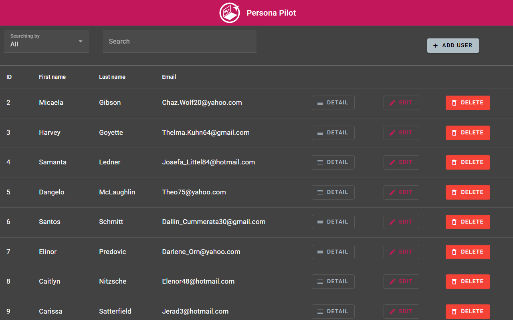

<div align="center">
  
  <h1>Persona Pilot</h1>
  <p>
    
    
    
    
    
    
  </p>
</div>



Application web Angular de gestion d'utilisateurs (« personas ») : liste paginée, recherche, tri, consultation, création, modification et suppression. Les données viennent d'une API REST simulée hébergée sur [MockAPI](https://mockapi.io/).

Projet développé en décembre 2023, d'abord hébergé sur la forge de l'université Lyon 1 sous le nom `my-user-list`.

## Branches

| Branche   | Contenu                                     |
| --------- | ------------------------------------------- |
| `main`    | `README.md` et ses images (`docs/images/`)  |
| `develop` | L'application Angular complète              |

Le code se trouve sur `develop` : les instructions ci-dessous partent de cette branche.

## Fonctionnalités

- **Liste des utilisateurs** : tableau paginé (10, 20 ou 50 lignes par page).
- **Recherche** sans distinction de casse, sur un champ au choix (prénom, nom, email, profession) ou sur tous à la fois (biographie incluse).
- **Tri** par colonne : ID, prénom, nom, email.
- **Fiche détaillée** de chaque utilisateur.
- **Création, modification et suppression**, avec une notification (snackbar) de 3 secondes après chaque action.
- **Page 404** pour les routes inconnues.

## Stack technique

| Élément                | Version                      |
| ---------------------- | ---------------------------- |
| Angular (CLI, core)    | 16.2                         |
| Angular Material / CDK | 16.2 (thème `pink-bluegrey`) |
| TypeScript             | 5.1                          |
| RxJS                   | 7.8                          |
| Tests                  | Karma 6.4, Jasmine 4.6       |

## Installation

Prérequis : Node.js et npm. Angular 16 prend officiellement en charge Node.js 16 et 18. Le projet s'installe et se compile aussi avec Node.js 23.11, mais le CLI affiche alors un avertissement de version non supportée.

```bash
git clone git@github.com:PennecStv/persona-pilot.git
cd persona-pilot
git checkout develop
npm ci
npm start
```

L'application est disponible sur <http://localhost:4200/>.

> **Attention :** l'URL de l'API est codée en dur et son jeu de données est partagé. Les créations, modifications et suppressions faites en local s'appliquent donc réellement à ces données.

## Scripts

| Commande        | Rôle                                                   |
| --------------- | ------------------------------------------------------ |
| `npm start`     | Serveur de développement avec rechargement automatique |
| `npm run build` | Build de production dans `dist/personapilot/`          |
| `npm run watch` | Build de développement en continu                      |
| `npm test`      | Tests unitaires avec Karma, en mode watch              |

## Routes

| Chemin             | Écran                                              |
| ------------------ | -------------------------------------------------- |
| `/`                | Redirige vers `/home`                              |
| `/home`            | Liste des utilisateurs                             |
| `/user/:id`        | Fiche détaillée                                    |
| `/update/user/:id` | Formulaire de modification                         |
| `/add`             | Formulaire de création                             |
| `/404`             | Page introuvable (toute route inconnue y redirige) |

## Architecture

```text
src/app/
├── 404/                     # Page introuvable
├── shared/
│   ├── models/user.model.ts       # Modèle User
│   └── services/
│       ├── http.service.ts        # Appels REST vers MockAPI
│       └── users.service.ts       # État partagé et notifications
├── user/
│   ├── user.component.*           # Liste, recherche, tri, suppression
│   ├── add-user/                  # Création
│   ├── detail-user/               # Fiche détaillée
│   └── update-user/               # Modification
├── app.module.ts
└── app.routes.ts            # Déclaration des routes
```

Les composants passent par `UsersService`, qui expose l'état de l'application dans des `BehaviorSubject` (`users`, `selectedUser`, `isLoading`) et délègue les appels réseau à `HttpService`.

### Données

L'API se trouve à l'adresse `https://658389484d1ee97c6bce044c.mockapi.io/api/v1/users`, définie dans `src/app/shared/services/http.service.ts`. Elle expose les opérations `GET`, `POST`, `PUT` et `DELETE` sur la ressource `users`.

| Champ        | Type     |
| ------------ | -------- |
| `id`         | `string` |
| `first_name` | `string` |
| `last_name`  | `string` |
| `email`      | `string` |
| `occupation` | `string` |
| `bio`        | `string` |

## Tests

Le projet contient 8 fichiers de specs, pour 10 tests. Pour les lancer une seule fois sans interface :

```bash
npx ng test --watch=false --browsers=ChromeHeadless
```

**État actuel : 3 tests réussis, 7 en échec.** Ce sont les specs générées par le CLI, qui n'ont pas été adaptées au code :

- 6 échecs viennent de l'absence de `HttpClient` dans le module de test (`No provider for HttpClient`).
- 1 échec vient de `AppComponent`, dont le test attend encore le texte du modèle Angular (`personapilot app is running!`).

## Limites connues

- **Pas de gestion d'erreur réseau** : si l'API échoue, le spinner reste affiché, et les notifications de succès s'affichent sans attendre la réponse du serveur.
- **Liste parfois périmée** : après une création ou une modification, la liste est rechargée sans attendre la fin de la requête d'écriture et peut donc afficher l'état précédent.
- **Formulaires sans validation** : aucun champ n'est obligatoire et le format de l'email n'est pas contrôlé. La limite de 100 caractères sur la biographie n'existe que dans le formulaire de modification.
- **Suppression immédiate**, sans demande de confirmation.
- **Budget de build dépassé** : le bundle initial pèse 886 kB, au-dessus du seuil d'avertissement de 500 kB fixé dans `angular.json`. Le build aboutit quand même.

## Déploiement

Le fichier `.gitlab-ci.yml` de `develop` date de l'hébergement sur GitLab : il construit l'application et la publie sur GitLab Pages depuis la branche par défaut. Il n'a aucun effet sur GitHub, et aucun déploiement n'est configuré pour ce dépôt.

## Auteur

Steve Pennec

Le dépôt ne contient pas de licence.
